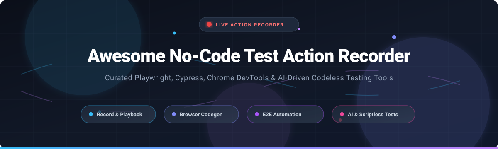

# 🚀 Awesome No-Code Test Action Recorder

  <strong>Curated catalog of top No-Code &amp; Low-Code Test Action Recorders, Codegen CLI tools, and Record-and-Playback Automation Frameworks.</strong>

  
  
  
  
  
  

> 🌟 **Star this repository if you find it helpful for modern QA and test automation!** 🌟  
> A comprehensive, SEO-optimized list of top No-Code Test Action Recorder platforms — spanning hosted SaaS AI suites, browser-native recorders, and production-grade open-source tools for recording user interactions and turning them into automated test scripts (Playwright, Cypress, Puppeteer, Selenium).

---

## 📋 Table of Contents

- [🌐 Sector Overview & Market Dynamics](#-sector-overview--market-dynamics)
- [🟦 SaaS / Hosted Platforms](#-saas--hosted-platforms)
- [🟩 Open-Source Software](#-open-source-software)
  - [1. Playwright Codegen](#1-playwright-codegen-)
  - [2. rrweb](#2-rrweb-)
  - [3. Selenium IDE](#3-selenium-ide-)
  - [4. UI Recorder](#4-ui-recorder-)
  - [5. Appium Inspector](#5-appium-inspector-)
  - [6. Puppeteer Replay](#6-puppeteer-replay-)
  - [7. Chrome DevTools Recorder](#7-chrome-devtools-recorder)
  - [8. DeploySentinel Recorder](#8-deploysentinel-recorder-)
  - [9. Katalon Recorder](#9-katalon-recorder-)
- [📊 Comparison at a Glance](#-comparison-at-a-glance)
- [📈 Star History](#-star-history)
- [💖 Support & Sponsorship](#-support--sponsorship)
- [🤝 Contributing](#-contributing)
- [📄 License](#-license)

---

## 🌐 Sector Overview & Market Dynamics

The global automated testing market is estimated at **$25B–$35B** (projected to exceed **$80B+ by the early 2030s** at a ~14–16% CAGR), propelled by continuous integration/continuous delivery (CI/CD) pipelines, QA shift-left practices, and generative AI adoption.

The sector remains **highly fragmented** rather than winner-take-all:
- **Enterprise Giants & Broad Platforms:** Companies like Tricentis (Testim) and BrowserStack dominate high-concurrency cross-browser execution clouds.
- **Agile Framework Vendors:** Tools like Cypress and Playwright dominate modern developer-first test authoring.
- **AI & Scriptless Innovators:** Emerging platforms leverage computer vision, LLM assertions, and self-healing locators to eliminate test maintenance overhead.

---

## 🟦 SaaS / Hosted Platforms

Commercial, cloud-hosted No-Code and Low-Code Test Action Recorder platforms. These are proprietary cloud solutions providing managed execution grids, AI validations, and enterprise team analytics.

| Platform | Company Valuation / Scale | Type | Starting Pricing | Free Tier / Trial Limit | Key Highlights | Best For |
|---|---|---|---|---|---|---|
| **Testim Recorder** | ~$4.5B valuation (Parent: Tricentis; acquired for $200M; ~$425M ARR) | Free Puppeteer recorder with codeless comparison | Paid plans start at ~$450/mo (Essentials tier based on parallel execution slots) | Permanent free Community Plan (up to 1,000 test runs/month after 14-day trial) | Free Puppeteer recorder converting interactions into Puppeteer code alongside codeless tests, with real-time updates and AI element locators. | Developers using Puppeteer wanting to accelerate test creation with a recorder that generates real Puppeteer code. |
| **BrowserStack Low-Code Automation** | $4B valuation (~$250M ARR; Series B unicorn) | AI-powered recorder within BrowserStack platform | Starts at $29/mo (Live manual testing) or $99/mo (Automate testing, billed annually) | Free trial with 30 min Live / 100 min Automate; unlimited access for qualified open source | AI-powered validations (visual, text, element presence), intelligent wait timeouts, custom JS actions, API simulation, and conditional loops. | Teams in the BrowserStack ecosystem wanting AI-assisted recording with built-in validation and debugging tools. |
| **mabl Trainer** | ~$400M valuation (~$25M–$35M ARR; $76M raised) | AI-powered low-code test recorder | Starts at ~$499/mo (quote-based based on test execution volume and tier) | 14-day free trial with full platform access (no permanent free tier) | Plain-language step descriptions, generative AI test authoring, self-healing tests, visual assertions, and local MCP server for AI agent integration. | Teams wanting AI-assisted recording with plain-language step descriptions and MCP integration for AI agents. |
| **Cypress Studio** | ~$60M+ valuation / $18M–$20M ARR ($55M+ venture raised) | Interactive test recorder within Cypress App | Starter plan is $0/mo; paid plans start at $67/mo (Team plan billed annually) | Permanent free Starter tier: 500 recorded test results/mo, up to 10 users, 30 days data retention | Embedded recorder in Cypress App generating native Cypress commands (`.click()`, `.type()`, etc.); selector priority strategy (`data-cy`, `data-test`, `id`). | Teams already writing Cypress tests wanting to accelerate test creation with a recorder that generates native Cypress commands. |
| **Ghost Inspector Recorder** | Bootstrapped / Acquired by SureSwift Capital (~$1M–$3M ARR) | Browser extension for recording regression tests | Starts at $109/mo (billed annually, includes 10,000 test runs/mo and 5 seats) | 14-day free trial with full features (no credit card required; no permanent free tier) | Chrome extension records user journeys and syncs to hosted continuous regression suite; schedule runs via API or cron across staging and production. | Teams wanting a simple browser-extension recorder tied to a hosted regression testing service, particularly for continuous monitoring. |

---

## 🟩 Open-Source Software

Self-hosted, community-driven No-Code and Codeless Test Action Recorder tools. Sorted in descending order by repository popularity (GitHub_Stars ⭐).

### 1. Playwright Codegen 
- **Repository:** [microsoft/playwright](https://github.com/microsoft/playwright) 🎭
- **Stack:** Node.js / Python / Java / .NET | **License:** Apache-2.0
- **Overview:** Playwright includes an integrated, zero-install **Codegen** command (`npx playwright codegen`) that launches a clean browser session, records mouse and keyboard interactions, and generates resilient test code in real time. It prioritizes user-facing accessibility locators (`role`, `text`, `test-id`) to prevent selector breakage. Includes built-in assertion generators (visibility, value, text), mobile viewport emulation, geolocation, and timezone overrides.
- **Best For:** Modern E2E web automation teams seeking a lightning-fast, native recorder without third-party vendor lock-in.

### 2. rrweb 
- **Repository:** [rrweb-io/rrweb](https://github.com/rrweb-io/rrweb) 📽️
- **Stack:** TypeScript / JavaScript | **License:** MIT
- **Overview:** An open-source record and replay library for the web. Rather than just capturing clicks, rrweb records all DOM mutations, mouse movements, inputs, and canvas draws into serializable data snapshots. It provides a pixel-perfect player to replay recorded journeys for visual regression, functional verification, and reproducible bug reports.
- **Best For:** Developers and QA engineers needing precise DOM-level user action recording and time-travel replay.

### 3. Selenium IDE 
- **Repository:** [SeleniumHQ/selenium-ide](https://github.com/SeleniumHQ/selenium-ide) 🌐
- **Stack:** Chrome / Firefox WebExtension | **License:** Apache-2.0
- **Overview:** The original, long-standing open-source record-and-playback extension for Selenium WebDriver. Features a graphical step editor, variable storage, conditional logic (`if/else`, loops), test suite grouping, and command-line execution via `selenium-side-runner`. Supports exporting recorded scripts into Python, Java, C#, and Ruby.
- **Best For:** QA teams with established Selenium grids wanting rapid test authoring through browser extension recording.

### 4. UI Recorder 
- **Repository:** [alibaba/uirecorder](https://github.com/alibaba/uirecorder) 📱
- **Stack:** Node.js / jWebDriver | **License:** MIT
- **Overview:** A zero-cost multi-platform UI test case recorder developed by Alibaba. Beyond standard browser recording, it features native **mobile app recording** (Android/iOS via macaca), Shadow DOM and SVG interaction support, 11 expectation types, Faker.js mock data integration, and auto-generated HTML/JUnit test reports with step-by-step screenshots.
- **Best For:** Teams needing cross-platform web and native mobile application recording in a unified CLI suite.

### 5. Appium Inspector 
- **Repository:** [appium/appium-inspector](https://github.com/appium/appium-inspector) 📲
- **Stack:** Electron / React / TypeScript | **License:** Apache-2.0
- **Overview:** The official GUI desktop companion for Appium. Provides element inspection, visual DOM exploration, and a built-in **Recorder** that converts live gestures, tap, swipe, and input actions on native Android and iOS screens into automated test scripts across Python, JavaScript, Java, and Ruby.
- **Best For:** Mobile automation engineers recording gestures and user actions directly against real devices or emulators.

### 6. Puppeteer Replay 
- **Repository:** [puppeteer/replay](https://github.com/puppeteer/replay) 🎬
- **Stack:** TypeScript / Node.js | **License:** Apache-2.0
- **Overview:** The official Google Puppeteer library and CLI for replaying and stringifying user flows recorded with the Chrome DevTools Recorder. Enables developers to run recordings headlessly in CI/CD pipelines, execute custom extension hooks, and convert user journeys into executable Puppeteer scripts.
- **Best For:** Headless CI execution and code generation directly from Chrome DevTools recording files.

### 7. Chrome DevTools Recorder
- **Repository:** [Chromium Project](https://developer.chrome.com/docs/devtools/recorder) 🛠️
- **Stack:** Browser-Native (Chromium) | **License:** BSD-3-Clause
- **Overview:** A built-in panel inside Google Chrome DevTools allowing developers to record, replay, and measure user flows without installing external extensions. Recordings can be edited, extended with performance metrics (Core Web Vitals), and exported to Cypress, Puppeteer, WebdriverIO, Nightwatch, and Testing Library formats.
- **Best For:** Developers desiring zero-installation browser recording with multi-framework export capabilities.

### 8. DeploySentinel Recorder 
- **Repository:** [DeploySentinel/Recorder](https://github.com/DeploySentinel/Recorder) ⚡
- **Stack:** Chrome Extension / TypeScript | **License:** MIT
- **Overview:** A modern browser extension that records user interactions in Chrome and instantly compiles them into Cypress, Playwright, or Puppeteer test scripts. Emphasizes clean code output, auto-scrolling assertions, and smart element locator strategies.
- **Best For:** Developers looking for a fast, one-click Chrome extension that exports clean code directly to Playwright or Cypress.

### 9. Katalon Recorder 
- **Repository:** [katalon-studio/katalon-recorder](https://github.com/katalon-studio/katalon-recorder) 📦
- **Stack:** Browser Extension (Chrome / Firefox / Edge) | **License:** GPL-3.0
- **Overview:** An open-source record-and-playback extension built as a modernized alternative to legacy Selenium IDE. Supports Selenese commands, Groovy scripting, multi-browser test execution, and direct export to multiple languages and frameworks.
- **Best For:** QA testers migrating legacy Selenese test scripts into a lightweight browser recorder.

---

## 📊 Comparison at a Glance

| Software | License | Stack | Target Framework | Assertions | Self-Hosted | Best For |
|----------|---------|-------|------------------|------------|-------------|----------|
| **Playwright Codegen** | Apache-2.0 | Node/Python/Java | Playwright | ✅ Toolbar assertions | ✅ (Built-in) | Resilient locators + multi-language codegen |
| **rrweb** | MIT | TypeScript | Custom / DOM Replay | ✅ Mutation snapshot | ✅ | Time-travel DOM recording & replay |
| **Selenium IDE** | Apache-2.0 | Extension | Selenium scripts | ✅ Command verify | ✅ | Legacy Selenium test suites & Selenese |
| **UI Recorder** | MIT | Node.js | jWebDriver | ✅ 11 assertion types | ✅ | Mobile native + Web application recording |
| **Appium Inspector** | Apache-2.0 | Electron | Appium (Py/JS/Java) | ✅ Inspector tree | ✅ | Android & iOS mobile interaction recording |
| **Puppeteer Replay** | Apache-2.0 | Node.js | Puppeteer | ✅ Step validation | ✅ | Headless CI execution of DevTools recordings |
| **Chrome DevTools** | Open Source | Browser-Native | Multi-framework | ✅ assertedEvents | ✅ (Browser) | Multi-framework export & Core Web Vitals |
| **DeploySentinel** | MIT | Extension | Cypress / Playwright | ✅ Action assertions | ✅ | Instant Chrome-to-Playwright/Cypress export |
| **Katalon Recorder** | GPL-3.0 | Extension | Katalon / Selenese | ✅ Built-in asserts | ✅ | Lightweight Selenese browser automation |
| **BrowserStack** | Proprietary | Cloud | Proprietary steps | ✅ AI validations | ❌ | AI-assisted recorder + cloud debugging grid |
| **Cypress Studio** | Proprietary | Cloud/Desktop | Cypress commands | ✅ (AI optional) | ❌ | Native Cypress test authoring |
| **mabl Trainer** | Proprietary | Cloud | Proprietary steps | ✅ Visual assertions | ❌ | Plain-language steps + MCP AI agent integration |
| **Testim Recorder** | Proprietary | Cloud | Puppeteer JS | ✅ Codeless locators | ❌ | Puppeteer code generation & self-healing |
| **Ghost Inspector** | Proprietary | Cloud | Hosted Regression | ✅ Visual/Text asserts | ❌ | Continuous web regression & scheduled monitoring |

---

## 📈 Star History

---

## 💖 Support & Sponsorship

If this curated list saved you hours of research or helped optimize your QA workflows, please consider supporting the project:

- ⭐ **Star this repository** on GitHub to support discoverability.
- 🍴 **Fork and contribute** tools, enhancements, and corrections.
- 📢 **Share with fellow QA engineers, SDETs, and developers** on Discord, LinkedIn, and Twitter.
- ☕ **Buy a coffee & sponsor ongoing maintenance:** [Sponsor Dashboard on GitHub](https://github.com/sponsors/ishandutta2007)

Thank you for your generous support and commitment to open-source software! 🙌

---

## 🤝 Contributing

Contributions are warmly welcome! If you know of a top No-Code Test Action Recorder tool, codegen utility, or open-source test recorder that should be listed here:

1. Fork this repository.
2. Add your project under the appropriate section with:
   - Project name and GitHub repository / website URL
   - Stack, license, and key differentiator
   - Why it stands out from other recorders
3. Submit a pull request.

Please verify that the software is actively maintained and relevant to test action recording and automation.

---

## 📄 License

This repository and curated list are released under the [Creative Commons Zero v1.0 Universal](https://creativecommons.org/publicdomain/zero/1.0/) (CC0 1.0) Public Domain Dedication. All listed tools, software products, and trademarks belong to their respective owners.

---

  Built with ❤️ for SDETs, QA Engineers, and Automation Enthusiasts worldwide.

